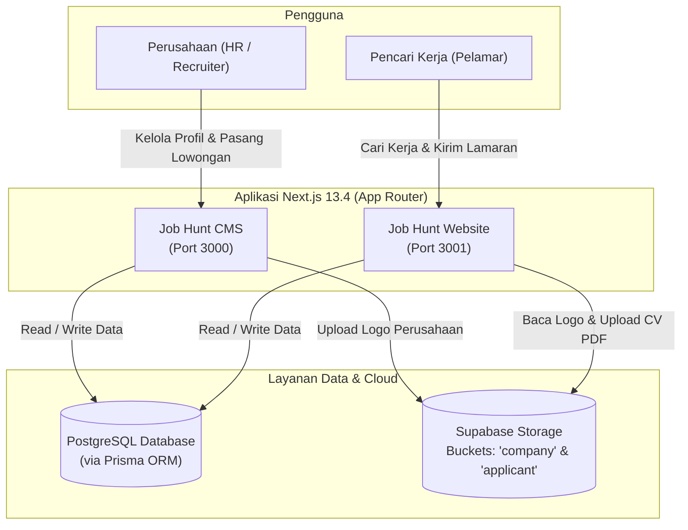
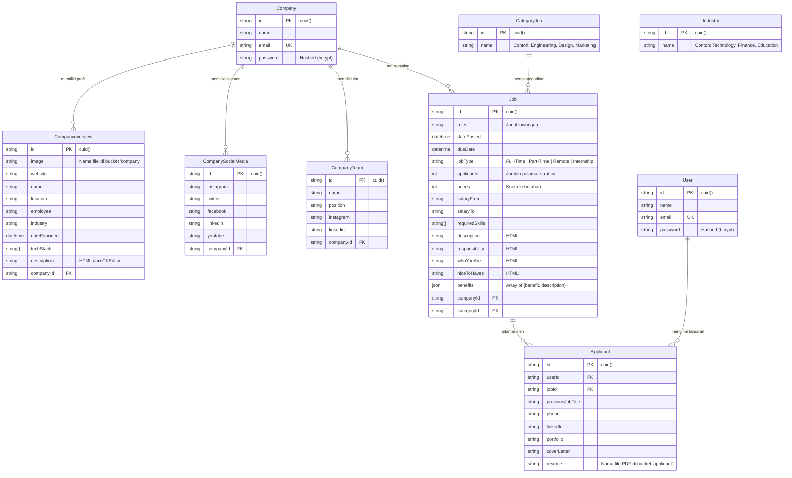

# Dokumentasi Lengkap Proyek Job Hunt (CMS & Website)

Proyek **Job Hunt** adalah platform pencarian kerja (*Job Portal*) berbasis ekosistem **Next.js 13.4 (App Router)**, **TypeScript**, **Prisma ORM**, **PostgreSQL**, dan **Supabase Storage**. Proyek ini terbagi menjadi dua aplikasi independen yang saling terhubung melalui satu basis data PostgreSQL dan penyimpanan objek (Supabase Storage) yang sama:

1. **Job Hunt CMS (`bwa-dashboard-job-hunt`)**: Dashboard internal bagi perusahaan (*Company / Employer*) untuk mengelola profil perusahaan, anggota tim, media sosial, memposting lowongan pekerjaan, dan melihat daftar pelamar kerja.
2. **Job Hunt Website (`bwa-job-hunt`)**: Portal publik bagi pencari kerja (*Job Seeker / User*) untuk menjelajahi lowongan kerja, mencari perusahaan berdasarkan industri/kategori, serta melamar pekerjaan secara langsung beserta unggahan CV/Resume.

---

## Daftar Isi

1. [Status Kompatibilitas & Kelayakan Jalan (Tahun 2023 vs Saat Ini)](#1-status-kompatibilitas--kelayakan-jalan-tahun-2023-vs-saat-ini)
2. [Arsitektur Sistem](#2-arsitektur-sistem)
3. [Teknologi yang Digunakan (Tech Stack)](#3-teknologi-yang-digunakan-tech-stack)
4. [Struktur Direktori Proyek](#4-struktur-direktori-proyek)
5. [Skema Database & Relasi (ERD)](#5-skema-database--relasi-erd)
6. [Konfigurasi Environment Variables & Supabase](#6-konfigurasi-environment-variables--supabase)
7. [Panduan Instalasi & Menjalankan Aplikasi](#7-panduan-instalasi--menjalankan-aplikasi)
8. [Dokumentasi Fitur, Halaman, dan Endpoint API](#8-dokumentasi-fitur-halaman-dan-endpoint-api)
9. [Catatan Teknis, Bug Bawaan & Tips Troubleshooting](#9-catatan-teknis-bug-bawaan--tips-troubleshooting)

---

## 1. Status Kompatibilitas & Kelayakan Jalan (Tahun 2023 vs Saat Ini)

Berdasarkan pengujian langsung pada lingkungan modern (**Node.js v25.8.1** & **npm v11.7.0**):
- **Instalasi Dependensi (`npm install`)**: **100% Berhasil** pada kedua folder (`Job Hunt CMS` dan `Job Hunt Website`).
- **Generasi Prisma Client (`npx prisma generate`)**: **100% Berhasil** (Prisma v5.2.0 berjalan lancar).
- **Kompilasi Tipe Statis (`npx tsc --noEmit`)**: **100% Lulus tanpa error TypeScript** di kedua proyek.
- **Kesimpulan**: Source code tahun 2023 ini **masih sangat layak dan bisa dijalankan sepenuhnya (Runnable)** tanpa perlu merombak ulang kode utama, asalkan Anda menyiapkan database **PostgreSQL** dan proyek **Supabase** baru.

---

## 2. Arsitektur Sistem

Kedua aplikasi berbagi satu database PostgreSQL dan satu instance Supabase Storage dengan dua *public bucket* (`company` dan `applicant`).



---

## 3. Teknologi yang Digunakan (Tech Stack)

| Kategori | Teknologi / Library | Versi | Keterangan |
| :--- | :--- | :--- | :--- |
| **Framework Utama** | Next.js (App Router) | `13.4.18` | Server Components, Client Components, & Route Handlers |
| **Bahasa Pemrograman** | TypeScript | `5.1.6` | Pengetikan statis di seluruh komponen dan API |
| **UI & Styling** | Tailwind CSS + Shadcn UI | `3.3.3` | Berbasis komponen primitif `@radix-ui/*` dan `lucide-react` |
| **Database ORM** | Prisma (`@prisma/client`) | `^5.2.0` | Skema database deklaratif & query builder untuk PostgreSQL |
| **Object Storage** | Supabase (`@supabase/supabase-js`) | `^2.33.x` | Penyimpanan file gambar logo perusahaan dan PDF resume |
| **Autentikasi** | NextAuth.js (`next-auth`) | `^4.23.1` | Menggunakan `CredentialsProvider` + JWT session & `bcryptjs` |
| **Manajemen Form** | React Hook Form + Zod | `^7.45.4` / `^3.22.2` | Validasi form dengan `@hookform/resolvers` |
| **Data Fetching (Client)** | SWR | `^2.2.1` | Fetching kategori, lowongan, dan filter dinamis di sisi klien |
| **Rich Text Editor** | CKEditor 5 Classic | `^39.0.1` | Digunakan pada CMS untuk deskripsi lowongan & profil perusahaan |
| **Utilitas Tanggal** | `moment` / `date-fns` / `dayjs` | Beragam | Pemformatan tanggal lowongan dan kalender |

---

## 4. Struktur Direktori Proyek

```text
d:\Project\Job-hunt\
├── Job Hunt CMS\                  # Aplikasi Dashboard Perusahaan (Employer)
│   ├── lib\
│   │   └── prisma.ts              # Singleton instance PrismaClient
│   ├── prisma\
│   │   └── schema.prisma          # Skema database utama (menggunakan env DATABASE_URL)
│   ├── public\                    # Aset statis
│   ├── src\
│   │   ├── app\
│   │   │   ├── (auth)\            # Grup rute autentikasi (/auth/signin, /auth/signup)
│   │   │   ├── (dashboard)\       # Grup rute terproteksi (/, /job-listings, /post-a-job, /settings, /job-detail/[id])
│   │   │   └── api\               # Route Handlers (auth, company, job)
│   │   ├── components\
│   │   │   ├── atoms\             # Komponen terkecil (TitleForm)
│   │   │   ├── forms\             # Form pengaturan (OverviewForm, SocialMediaForm, TeamForm)
│   │   │   ├── layouts\           # Sidebar & Header dashboard
│   │   │   ├── organisms\         # Komponen kompleks (Applicants, CKEditor, CustomUpload, InputBenefits, InputSkills, JobDetail)
│   │   │   └── ui\                # Komponen Shadcn UI (button, dialog, form, table, tabs, dll.)
│   │   ├── constants\             # Konstanta opsi lokasi, jumlah karyawan, tipe pekerjaan
│   │   ├── context\               # NextAuthProvider
│   │   └── lib\                   # Skema validasi Zod (form-schema.ts), helper Supabase (supabase.ts), & utilitas (utils.ts)
│   ├── env.example                # Template variabel environment CMS
│   ├── next.config.js             # Konfigurasi domain gambar Supabase
│   └── package.json
│
└── Job Hunt Website\              # Aplikasi Portal Pencari Kerja (Public / Job Seeker)
    ├── lib\
    │   └── prisma.ts              # Singleton instance PrismaClient
    ├── prisma\
    │   └── schema.prisma          # Skema database Website (menggunakan env POSTGRES_PRISMA_URL)
    ├── public\
    │   └── images\                # Aset ilustrasi, ikon sosial media, dan placeholder gambar
    ├── src\
    │   ├── app\
    │   │   ├── (auth)\            # Grup rute autentikasi pelamar (/signin, /signup)
    │   │   ├── (landingpage)\     # Grup rute halaman publik (/, /find-jobs, /find-companies, /detail/job/[id], /detail/company/[id])
    │   │   └── api\               # Route Handlers (auth, company, jobs, user)
    │   ├── components\
    │   │   ├── atoms\             # TitleSection
    │   │   ├── layouts\           # Navbar & Footer
    │   │   ├── organisms\         # Hero, Category, FeaturedJobs, LatestJobs, FormModalApply, FormFilterDynamic, UploadField, dll.
    │   │   └── ui\                # Komponen Shadcn UI
    │   ├── containers\            # ExploreDataContainer (layout pencarian kerja & perusahaan)
    │   ├── hooks\                 # Custom SWR hooks (useJobs, useCompanies, useFeaturedJobs, dll.)
    │   ├── lib\                   # Validasi Zod, helper Supabase, & utilitas
    │   ├── providers\             # AuthProvider (NextAuth SessionProvider)
    │   └── types\                 # Definisi tipe data TypeScript
    ├── .env.example               # Template variabel environment Website
    ├── next.config.js             # Konfigurasi gambar (unoptimized: true)
    └── package.json
```

---

## 5. Skema Database & Relasi (ERD)

Database PostgreSQL terdiri dari **9 tabel/model** yang dikelola melalui Prisma:



---

## 6. Konfigurasi Environment Variables & Supabase

### A. Persiapan Supabase (Database & Storage)
1. Buat proyek baru di [Supabase](https://supabase.com/) (atau gunakan PostgreSQL lokal/cloud untuk database + Supabase untuk Storage).
2. Masuk ke menu **Storage** di dashboard Supabase, lalu buat **2 bucket dengan akses Public (`Public bucket = ON`)**:
   - Nama bucket 1: `company` (menyimpan foto/logo perusahaan di dalam path `public/<filename>.jpg`)
   - Nama bucket 2: `applicant` (menyimpan dokumen CV/Resume di dalam path `public/resume-<id>.pdf`)
3. Pastikan **Storage Policies (RLS)** pada kedua bucket (`company` dan `applicant`) mengizinkan operasi `SELECT`, `INSERT`, `UPDATE`, dan `DELETE` untuk role `anon` / `public` (karena aplikasi mengunggah file langsung dari sisi klien menggunakan `NEXT_PUBLIC_SUPABASE_PUBLIC_KEY`).

### B. Konfigurasi `.env` pada `Job Hunt CMS`
Salin file `env.example` menjadi `.env` di dalam folder `Job Hunt CMS`:

```env
DATABASE_URL="postgresql://postgres:[PASSWORD]@[HOST]:5432/postgres"
NEXT_PUBLIC_SUPABASE_URL="https://[PROJECT_ID].supabase.co"
NEXT_PUBLIC_SUPABASE_PUBLIC_KEY="eyJhbGciOiJIUzI1NiIsInR5cCI6IkpXVCJ9..."
NEXTAUTH_SECRET="rahasia-jwt-cms-anda-minimal-32-karakter"
NEXTAUTH_URL="http://localhost:3000"
```

> **Penting untuk `Job Hunt CMS/next.config.js`**:
> Buka `Job Hunt CMS/next.config.js` dan sesuaikan `hostname` dengan domain Supabase Anda agar komponen `<Image />` Next.js mengizinkan pemuatan gambar dari proyek Supabase Anda:
> ```javascript
> const nextConfig = {
>   images: {
>     remotePatterns: [
>       {
>         protocol: "https",
>         hostname: "[PROJECT_ID].supabase.co", // Ganti dengan hostname Supabase Anda
>       },
>     ],
>   },
> };
> ```

### C. Konfigurasi `.env` pada `Job Hunt Website`
Salin file `.env.example` menjadi `.env` di dalam folder `Job Hunt Website`:

```env
POSTGRES_PRISMA_URL="postgresql://postgres:[PASSWORD]@[HOST]:5432/postgres"
NEXT_PUBLIC_SUPABASE_URL="https://[PROJECT_ID].supabase.co"
NEXT_PUBLIC_SUPABASE_PUBLIC_KEY="eyJhbGciOiJIUzI1NiIsInR5cCI6IkpXVCJ9..."
NEXTAUTH_SECRET="rahasia-jwt-website-anda-minimal-32-karakter"
NEXTAUTH_URL="http://localhost:3001"
```
*(Perhatikan bahwa `Job Hunt CMS` menggunakan nama variabel `DATABASE_URL`, sedangkan `Job Hunt Website` menggunakan `POSTGRES_PRISMA_URL`. Arahkan keduanya ke URL database PostgreSQL yang sama).*

---

## 7. Panduan Instalasi & Menjalankan Aplikasi

Ikuti langkah-langkah berikut secara berurutan:

### Langkah 1: Instalasi & Sinkronisasi Database (Melalui Job Hunt CMS)
Buka terminal pada direktori `Job Hunt CMS`:

```powershell
cd "d:\Project\Job-hunt\Job Hunt CMS"

# 1. Install dependensi
npm install

# 2. Push skema Prisma ke database PostgreSQL Anda
npx prisma db push

# 3. Generate Prisma Client
npx prisma generate
```

### Langkah 2: Mengisi Data Master Awal (`CategoryJob` & `Industry`)
Sebelum perusahaan dapat mengatur profil atau memposting lowongan di CMS, tabel `CategoryJob` dan `Industry` **wajib memiliki data awal** (karena dropdown di CMS mengambil data dari kedua tabel ini). Anda dapat mengisinya dengan mudah menggunakan **Prisma Studio**:

```powershell
cd "d:\Project\Job-hunt\Job Hunt CMS"
npx prisma studio
```
Buka `http://localhost:5555` di browser, lalu tambahkan beberapa baris data pada:
- **Model `CategoryJob`**: Misalnya `Software Engineering`, `UI/UX Design`, `Marketing`, `Data Science`, `Human Resource`.
- **Model `Industry`**: Misalnya `Technology`, `Finance & Banking`, `E-Commerce`, `Healthcare`, `Education`.

### Langkah 3: Menjalankan Job Hunt CMS (Port 3000)
```powershell
cd "d:\Project\Job-hunt\Job Hunt CMS"
npm run dev
```
Akses CMS di: `http://localhost:3000`

### Langkah 4: Instalasi & Menjalankan Job Hunt Website (Port 3001)
Buka terminal baru untuk `Job Hunt Website` (jalankan di port `3001` agar tidak bentrok dengan CMS di port `3000`):

```powershell
cd "d:\Project\Job-hunt\Job Hunt Website"

# 1. Install dependensi
npm install

# 2. Generate Prisma Client
npx prisma generate

# 3. Jalankan server development di port 3001
npx next dev -p 3001
```
Akses Website di: `http://localhost:3001`

---

## 8. Dokumentasi Fitur, Halaman, dan Endpoint API

### A. Job Hunt CMS (Dashboard Perusahaan)

#### Daftar Halaman (Routes)
| Path URL | Akses | Deskripsi Fitur |
| :--- | :--- | :--- |
| `/auth/signup` | Publik | Registrasi akun perusahaan baru (`Company`). |
| `/auth/signin` | Publik | Login akun perusahaan menggunakan email & password. |
| `/` | Terproteksi | Halaman beranda dashboard (Redirect otomatis ke `/auth/signin` jika belum login). |
| `/settings` | Terproteksi | Pengaturan profil perusahaan yang terbagi dalam 3 tab: **Overview** (logo, nama, lokasi, industri, tech stack, deskripsi), **Social Links** (Facebook, Instagram, LinkedIn, Twitter, YouTube), dan **Teams** (daftar & tambah anggota tim). |
| `/post-a-job` | Terproteksi | Formulir pembuatan lowongan kerja baru dengan validasi Zod, input skill dinamis, editor HTML CKEditor 5, dan daftar benefit. |
| `/job-listings` | Terproteksi | Tabel daftar seluruh lowongan kerja yang diposting oleh perusahaan terkait beserta status (`Live` / `Expired`), tanggal tayang, dan rasio pelamar (`applicants / needs`). |
| `/job-detail/[id]` | Terproteksi | Detail lowongan kerja yang memiliki 2 tab: **Applicants** (daftar pelamar beserta tautan kontak/info) dan **Job Details** (ringkasan informasi lowongan). |

#### Daftar Endpoint API (`Job Hunt CMS`)
| Method | Endpoint | Deskripsi |
| :--- | :--- | :--- |
| `GET/POST` | `/api/auth/[...nextauth]` | Handler autentikasi NextAuth untuk tabel `Company`. |
| `POST` | `/api/company/new-user` | Membuat akun perusahaan baru dengan password yang di-hash menggunakan `bcryptjs`. |
| `GET` | `/api/company/industry` | Mengambil seluruh daftar industri dari tabel `Industry`. |
| `POST` | `/api/company/overview` | Melakukan *upsert* (buat baru atau perbarui) data profil `Companyoverview`. |
| `POST` | `/api/company/social-media` | Melakukan *upsert* data tautan sosial media pada tabel `CompanySocialMedia`. |
| `POST` | `/api/company/teams` | Menambahkan anggota tim baru ke tabel `CompanyTeam`. |
| `GET` | `/api/job/categories` | Mengambil seluruh kategori lowongan dari tabel `CategoryJob`. |
| `POST` | `/api/job` | Menyimpan data lowongan kerja baru ke tabel `Job`. |

---

### B. Job Hunt Website (Portal Pencari Kerja)

#### Daftar Halaman (Routes)
| Path URL | Akses | Deskripsi Fitur |
| :--- | :--- | :--- |
| `/` | Publik | Landing page utama yang menampilkan komponen `Hero`, `Clients`, `Category` (jumlah lowongan per kategori), `BannerSignUp`, `FeaturedJobs`, dan `LatestJobs`. |
| `/signup` | Publik | Registrasi akun pencari kerja baru (`User`). |
| `/signin` | Publik | Login akun pencari kerja. |
| `/find-jobs` | Publik | Halaman eksplorasi dan pencarian lowongan kerja dengan filter dinamis berdasarkan kategori pekerjaan (`CategoryJob`). |
| `/find-companies` | Publik | Halaman eksplorasi daftar perusahaan dengan filter dinamis berdasarkan kategori industri (`Industry`). |
| `/detail/job/[id]` | Publik & User | Menampilkan detail lengkap lowongan kerja, kuota pelamar, kategori, skill, dan benefit. Jika user sudah login, tombol **Apply** akan aktif dan membuka modal formulir lamaran kerja beserta unggahan PDF resume. |
| `/detail/company/[id]` | Publik | Menampilkan profil lengkap perusahaan, jumlah lowongan aktif, lokasi, karyawan, tech stack, sosial media, daftar anggota tim, dan lowongan terbaru. |

#### Daftar Endpoint API (`Job Hunt Website`)
| Method | Endpoint | Deskripsi |
| :--- | :--- | :--- |
| `GET/POST` | `/api/auth/[...nextauth]` | Handler autentikasi NextAuth untuk tabel `User`. |
| `POST` | `/api/user` | Registrasi akun pencari kerja (`User`) dengan hashing password `bcryptjs`. |
| `GET` | `/api/jobs/categories` | Mengambil daftar `CategoryJob` beserta jumlah lowongan (`_count.Job`) di setiap kategori. |
| `GET` | `/api/jobs/featured` | Mengambil maksimal 6 lowongan kerja terbaru beserta relasi `CategoryJob` dan `Companyoverview`. |
| `GET` | `/api/jobs/filter` | Mengambil daftar lowongan kerja yang difilter berdasarkan query parameter `?category=id1,id2`. |
| `POST` | `/api/jobs/apply` | Menyimpan data lamaran ke tabel `Applicant` sekaligus menambahkan counter `applicants` (+1) pada tabel `Job`. |
| `GET` | `/api/company/categories` | Mengambil daftar seluruh industri (`Industry`) untuk filter perusahaan. |
| `GET` | `/api/company/filter` | Mengambil daftar perusahaan yang difilter berdasarkan query parameter `?category=namaIndustri1,namaIndustri2`. |

---

## 9. Catatan Teknis, Bug Bawaan & Tips Troubleshooting

Saat menjalankan proyek ini, perhatikan beberapa karakteristik kode bawaan dari tahun 2023 berikut agar Anda tidak mengalami kendala:

1. **Urutan Penggunaan untuk Perusahaan Baru (Wajib Isi Settings Terlebih Dahulu)**:
   - Pada halaman `Job Hunt Website` (`/detail/job/[id]` dan `/detail/company/[id]`), kode mengakses `data.Company.Companyoverview[0].image` dan `data.Company.Companyoverview[0].name` secara langsung.
   - **Solusi**: Setelah mendaftar akun perusahaan baru di **Job Hunt CMS**, **wajib mengisi dan menyimpan tab `Settings -> Overview` serta `Settings -> Social Links` terlebih dahulu** sebelum memposting lowongan kerja (`Post a Job`), agar array `Companyoverview[0]` dan `CompanySocialMedia[0]` tidak bernilai `undefined` saat dilihat dari Website.
2. **Perbedaan Nama Variabel Database di `.env`**:
   - Pastikan file `.env` di **Job Hunt CMS** menggunakan variabel `DATABASE_URL`, sedangkan file `.env` di **Job Hunt Website** menggunakan `POSTGRES_PRISMA_URL`.
3. **Konflik Cookie Session `next-auth` di `localhost`**:
   - Karena baik CMS (`localhost:3000`) maupun Website (`localhost:3001`) berjalan di domain `localhost` yang sama, cookie sesi NextAuth (`next-auth.session-token`) dapat saling menimpa jika dibuka di jendela browser yang sama.
   - **Solusi**: Gunakan jendela browser biasa untuk **Job Hunt CMS** dan jendela *Incognito / Private Window* (atau profil browser berbeda) untuk **Job Hunt Website** saat menguji keduanya secara bersamaan.
4. **Sinkronisasi Skema Prisma**:
   - Skema Prisma di folder `Job Hunt CMS/prisma/schema.prisma` menggunakan `@default(cuid())` pada semua model, sedangkan di `Job Hunt Website/prisma/schema.prisma` hanya `User` dan `Applicant` yang memiliki `@default(cuid())` (karena model lainnya dibuat melalui CMS). Oleh karena itu, selalu jalankan perintah migrasi atau `npx prisma db push` dari direktori **`Job Hunt CMS`**.
